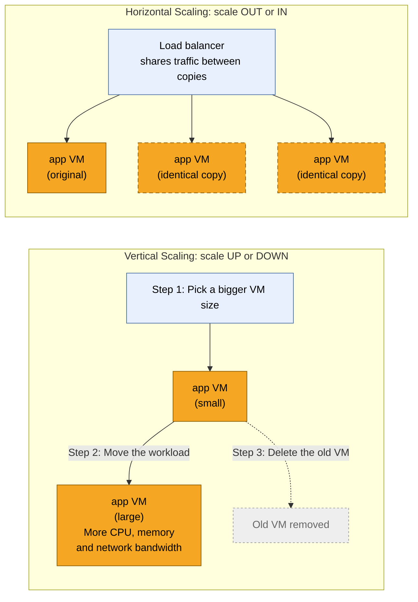

## What is autoscaling?

Autoscaling is when a cloud system automatically adds or removes computing resources based on demand.

'AWS Auto Scaling monitors your applications and automatically adjusts capacity to maintain steady, predictable performance at the lowest possible cost.'

**Two types of scaling**

Vertical scaling (scaling up/down): make a single machine bigger or smaller by adding CPU, RAM, or storage.

Horizontal scaling (scaling out/in): add or remove machines (instances) and spread the load across them with a load balancer.

> Vertical scaling

Pros:
- Simple: no changes to the app or its code are needed
- Keeps all data in one place, so it suits stateful apps like databases
- No need to keep multiple copies in sync
- Quick performance boost from more CPU, memory, or faster storage
- Fewer machines to manage, monitor, and patch

Cons:
- Hardware limit: you can only make one machine so big
- Often needs a restart or brief downtime to resize
- Single point of failure: if the one machine goes down, the app goes down
- Large machines get expensive quickly
- Can't easily scale back down in small steps to save money

> Horizontal scaling

Pros:
- Almost no upper limit, can keep adding more machines
- High availability: if one machine fails, the others keep running
- Usually no downtime when scaling, since new copies are added alongside existing ones
- Can scale to match the demand
- Can use cheaper, smaller machines instead of one expensive large one

Cons:
- More complex: needs a load balancer to share traffic between machines
- Works best for stateless apps - web servers, restAPIs, static websites
- More machines to manage, monitor, and update
- Keeping data consistent across copies can be hard

# Auto-scaling guide

> 1. Create a launch template for the app (AMI, instance type, key pair, user data).

- A security group on the launch template that allows:
  - HTTP (port 80) from anywhere (0.0.0.0/0), so the load balancer can reach the app
  - SSH (port 22) from My IP, so you can connect for testing
  
> 2. Choose the launch template

Go to EC2 → Auto Scaling groups → Create Auto Scaling group.

- Name: tech613-daria-app-asg
- Launch template: select yours

> 3. Choose where instances launch

- VPC: the default VPC
- Availability Zones and subnets: select all three subnets (eu-west-1a, 1b and 1c).
- Instance type requirements:** leave it as the launch template.

> 3. Add the load balancer and health checks

- Load balancing: Attach to a new load balancer
- Load balancer type: Application Load Balancer
- Load balancer name: tech613-daria-app-lb
- Load balancer scheme: Internet-facing
- Network mapping: the same three subnets
- Listeners and routing:
  - Port: 80
  - Default routing: Create a target group, named tech613-daria-app-tg
- VPC Lattice: No
- Health checks: tick - Turn on Elastic Load Balancing health checks
- Health check grace period: 300 seconds. This gives each new instance time to boot and start the app before it's checked.
- Monitoring: tick Enable group metrics collection within CloudWatch

> 4. Group size and scaling policy

Desired capacity: 2

Min desired capacity: 2

Max desired capacity: 3

Under Automatic scaling:

- Select Target tracking scaling policy
- Scaling policy name: tech613-daria-cpu-50
- Metric type: Average CPU utilisation
- Target value: 50
- Instance warmup: 300 seconds. This is how long a new instance runs before its CPU counts towards the group average, so a booting instance doesn't trigger extra scaling.

Instance maintenance policy: No policy.

## 5. Add notifications

Skip 

## 6. Add tags

skip

## 7. Review

Check the settings, then click Create Auto Scaling group.

## 8. Check the load balancer's security group

Go to EC2 → Load Balancers → tech613-daria-app-lb → Security tab.

Make sure its security group allows HTTP (port 80) from 0.0.0.0/0. If it doesn't

## 9. Test the app through the load balancer

1. Go to EC2 → Target groups → tech613-daria-app-tg → Targets. Wait until both instances show Healthy
2. Go to EC2 → Load Balancers, select tech613-daria-app-lb and copy the DNS name
3. Open `http://<DNS name>` in your browser. The app should load.

