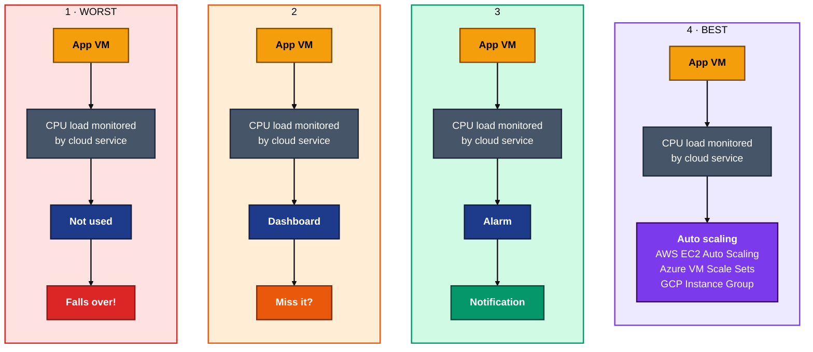

# MONITORING DEPLOYED SYSTEMS

## The need for monitoring 

- to detect failures faster than end users
- faster diagnosis of the problem
- to anticipate capacity problems
- drive business and cost decisions

## worst--best case preparation

| Position   | Protecting Against                    | Monitoring's role                                 | Typical signal                                 |
| ---------- | ------------------------------------------------- | ------------------------------------------------- | ---------------------------------------------- |
| Worst case | Outage, data loss, dependency failure, breach     | Detect fast, bound blast radius, trigger rollback | Error rate, availability, failed health checks |
| Base case  | Slow drift, creeping latency, capacity exhaustion | Trend and forecast, stay within SLO               | Saturation, p95 latency, error budget burn     |
| Best case  | Demand spike you can't serve, wasted headroom     | Prove headroom, tune cost, show reliability       | Traffic rate, throughput per pound, adoption   |

Worst case monitoring looks at 3 things:

- it tells you you're in the worst case
- it tells you how far the damage has spread
- gives you the trigger for the contingency plan you already wrote

Base case is the everyday swing range between worst and best, main job is to keep the system
in the good end of the range.

Best case scenarios assume favourable conditions such as 

- higher demand
- better conversion
- everything lands on schedule
- faster-than-expected adoption or uptake
- costs come in under budget
- dependencies and integrations deliver without rework
- churn or error rates stay below forecast
- hiring and training fill faster than planned




## Performance testing -- Documentation

1. Launch app instance and SSH in, check if the browser works
2. go to instance summary, click monitoring in tags


3. Click manged detailed monitoring - [ X ] tick enabled
4. Click confirm, then click the 3 dots on the right side, then add dashboard
5. Click on add dashboard > create dashboard >add new


# using apache package to simulate network traffic

6. Go to the VM root


```bash
sudo apt install apache2-utils
 ab -n 1000 -c 10 http://18.203.156.41/  # ip address of the app
```

apache bench is used for this (ab) command

- this should produce noticeable spikes in the dashboard

# Alarm alert for cpu usage - with email notification

1. Find instance ID
2. EC2 → Instances → tick the instance → Actions → Monitor and troubleshoot → Manage CloudWatch alarms.
3. Set up email Notification → Alarm state trigger: In alarm
4. Send a notification to: Create new topic
- Topic name: tech613-daria-cpu-alarm
- Email endpoints: <your-name>@email.com
5. click create topic then click next
6. Confirm the email via email (from aws)
7. Add the alarm to the dashboard - CloudWatch → Alarms → tick the alarm → Actions → Add to dashboard → choose the app dashboard.

dashboard 

Email


