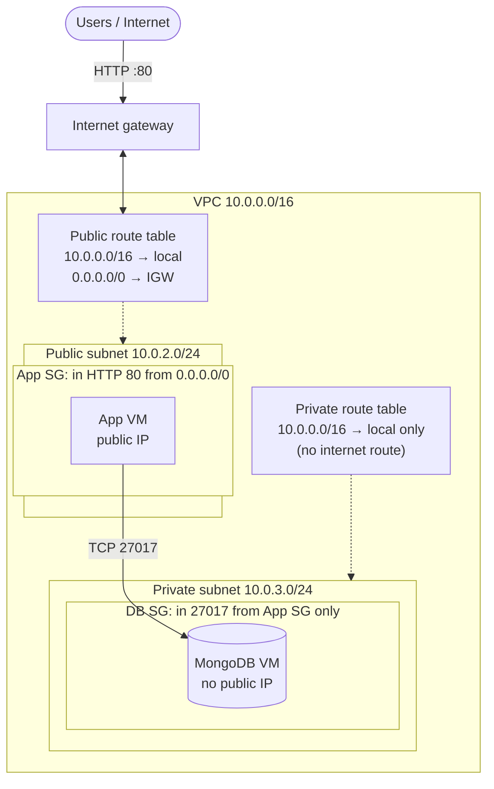

# Building a Secure Two-Tier VPC Architecture on AWS

## Key concepts

- VPC is a logically isolated private network
- Subnets segment the VPC into public and private zones
- Route tables control traffic flow within the VPC
- Internet gateway enables inbound/outbound internet traffic
- Public subnet has a route to the internet gateway
- Private subnet lacks direct internet gateway route
- Security groups filter traffic at instance level
- Use pre-configured AMIs for instances without internet access

# Custom VPC for improved DB security

10.0.0.0/16

1. **Create the VPC**: Go to VPCs in AWS console, click 'Create VPC', set name (e.g., 'two-tier-first-vpc'), specify CIDR block (e.g., 10.0.0.0/16), and create.

1. **Create public and private subnets**: In Subnets section, create two subnets in the VPC: public subnet with CIDR 10.0.2.0/24 in availability zone A, private subnet with CIDR 10.0.3.0/24 in availability zone B.

> Adding subnets

1. **Create and attach an Internet Gateway**: In Internet Gateways, create a new IGW named after the VPC (e.g., 'two-tier-first-vpc-IG'), then attach it to the VPC.

> Add internet gateway

1. **Create a public route table and associate it with the public subnet**: Create a route table named 'public route table' for the VPC, edit subnet associations to associate only the public subnet.

1. **Add a route to the Internet Gateway in the public route table**: Edit routes in the public route table, add a route with destination 0.0.0.0/0 and target as the Internet Gateway.

> Adding routes

> 
subnet associatioans
routes> edit routes 

1. **Launch the database virtual machine in the private subnet**: Go to EC2 AMIs, select a pre-configured database AMI, launch instance in the private subnet of the VPC, create a new security group allowing SSH and MongoDB ports only from the public subnet CIDR (10.0.2.0/24).

1. **Launch the app virtual machine in the public subnet**: Select the app AMI, launch instance in the public subnet with a public IP, create a new security group allowing SSH from your IP and HTTP from anywhere.

1. **Configure app instance user data to start the app**: Add user data script to CD into the app folder and start the app using PM2, including setting the MongoDB URI environment variable with the private IP of the database VM.

1. **Verify architecture and connectivity**: Check VPC resource map to confirm subnet, route table, and internet gateway connections; test app connectivity via public IP and troubleshoot errors like 502 bad gateway.