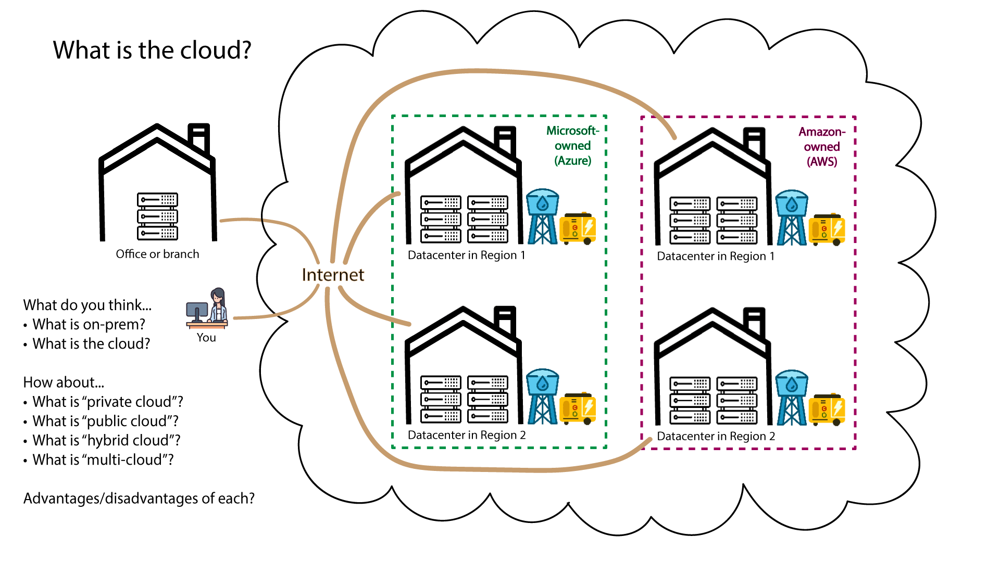

# What is cloud computing?

computing resources on demand accessed via the internet
- often has GUI
- pay as you go services
- global

on-prem: on premesis: using netflix in browser: cloud, using netflix app: on prem

What is cloud computing?

On-demand delivery of computing power, database storage, applications and other IT resources
Often has a cloud service platform (GUI)
Usually has pay-as-you-go pricing
You can provision exactly the right type and size of computing resources you need
You can access many resources, almost instantly
Cloud provider owns and maintains the network and hardware (and security for it up to a certain point - see Types of Cloud Services)

## simple 
public cloud  -> shared tenancy
private cloud -> sole tenancy

a company may have a data-center to 

## complex 
Hybrid --> public + private (everything that needs to be there)
complex to join them up 
mulit- cloud 
may have a few clouds joined up

## Definitions by NIST

Cloud computing is a model for enabling ubiquitous, convenient, on-demand network access to a shared
pool of configurable computing resources :
- networks
- servers
- storage
- applications
- and services

This cloud model is composed of five essential characteristics, three service models, and four deployment
models.

## Essential Characteristics:

On-demand self-service. A consumer can unilaterally provision computing capabilities, such as
server time and network storage, as needed automatically without requiring human
interaction with each service provider.

**Broad network access** Capabilities are available over the network and accessed through standard
mechanisms that promote use by heterogeneous thin or thick client platforms (e.g.,
mobile phones, tablets, laptops, and workstations).

**Resource pooling** The provider’s computing resources are pooled to serve multiple consumers
using a multi-tenant model, with different physical and virtual resources dynamically
assigned and reassigned according to consumer demand. There is a sense of location
independence in that the customer generally has no control or knowledge over the exact
location of the provided resources but may be able to specify location at a higher level of
abstraction (e.g., country, state, or datacenter). Examples of resources include storage,
processing, memory, and network bandwidth.

**Rapid elasticity** Capabilities can be elastically provisioned and released, in some cases
automatically, to scale rapidly outward and inward commensurate with demand. To the
consumer, the capabilities available for provisioning often appear to be unlimited and can
be appropriated in any quantity at any time.

**Measured service** Cloud systems automatically control and optimize resource use by leveraging
a metering capability1 at some level of abstraction appropriate to the type of service (e.g.,
storage, processing, bandwidth, and active user accounts). Resource usage can be
monitored, controlled, and reported, providing transparency for both the provider and
consumer of the utilized service.

## Service Models:

**Software as a Service (SaaS)** The capability provided to the consumer is to use the provider’s
applications running on a cloud infrastructure , usually when accessed via the browser
. The applications are accessible from
various client devices through either a thin client interface, such as a web browser (e.g.,
web-based email), or a program interface. 

- The consumer does not manage or control the underlying cloud infrastructure including network, servers, operating systems, storage, or
even individual application capabilities, with the possible exception of limited userspecific application configuration settings.

**Platform as a Service (PaaS)** 
Cloud provider gives the environment to build work inside of, emv where you can host application
The capability provided to the consumer is to deploy onto the cloud
infrastructure consumer-created or acquired applications created using programming

 1. Typically this is done on a pay-per-use or charge-per-use basis. 

 2. A cloud infrastructure is the collection of hardware and software that enables the five essential characteristics of cloud
computing. The cloud infrastructure can be viewed as containing both a physical layer and an abstraction layer. The physical
layer consists of the hardware resources that are necessary to support the cloud services being provided, and typically includes
server, storage and network components. The abstraction layer consists of the software deployed across the physical layer,
which manifests the essential cloud characteristics. Conceptually the abstraction layer sits above the physical layer.

 3. The consumer does not manage or control the underlying cloud infrastructure including network, servers,
operating systems, or storage, but has control over the deployed applications and possibly
configuration settings for the application-hosting environment.

 **Infrastructure as a Service (IaaS)** 
 The capability provided to the consumer is to provision processing, storage, networks, and other fundamental computing resources where the
consumer is able to deploy and run arbitrary software, which can include operating
systems and applications. The consumer does not manage or control the underlying cloud
infrastructure but has control over operating systems, storage, and deployed applications;
and possibly limited control of select networking components (e.g., host firewalls).

**Function as a Servive(Faas)**
via ETL pipelines -> systems monitioring 

## Deployment Models:

**Private cloud** The cloud infrastructure is provisioned for exclusive use by a single organization
comprising multiple consumers (e.g., business units). It may be owned, managed, and
operated by the organization, a third party, or some combination of them, and it may exist
on or off premises.

**Community cloud** The cloud infrastructure is provisioned for exclusive use by a specific
community of consumers from organizations that have shared concerns (e.g., mission,
security requirements, policy, and compliance considerations). It may be owned,
managed, and operated by one or more of the organizations in the community, a third
party, or some combination of them, and it may exist on or off premises.

**Public cloud** The cloud infrastructure is provisioned for open use by the general public. It may be
owned, managed, and operated by a business, academic, or government organization, or
some combination of them. It exists on the premises of the cloud provider.

**Hybrid cloud** The cloud infrastructure is a composition of two or more distinct cloud
infrastructures (private, community, or public) that remain unique entities, but are bound
together by standardized or proprietary technology that enables data and application
portability (e.g., cloud bursting for load balancing between clouds). 

** multi-cloud** 

reference: https://csrc.nist.gov/pubs/sp/800/145/final

# What is the Difference Between Cloud And On Premises?

The primary differences between cloud and on premises computing models are the location of your physical 
IT infrastructure and who manages that infrastructure. 

Your organization owns and maintains on premises infrastructure on site in your data center. You, or your delegates, 
have full control over hardware, security, and operations.

In a cloud computing model, you access various services, such as public cloud services for storage, computing power, 
or databases, from a cloud provider such as Amazon Web Services (AWS).
The cloud provider manages the physical infrastructure.

Although on premises systems offer direct control and can be preferred in some use cases, they often need significant 
upfront investment and ongoing maintenance. In contrast, cloud environments offer more flexibility and scalability, 
and can reduce the long-term resource overhead of managing physical IT infrastructure.

# Cloud vs on premises

## Summary table

| Area | On premises | Cloud |
|---|---|---|
| **Ownership** | You own and house the hardware in your own data centre | The provider (e.g. AWS) owns the hardware; you pay for services |
| **Configuration** | Full control over every setting | Highly configurable, but only within the provider's architecture |
| **Management** | You handle the whole lifecycle: install, patch, monitor, fix, retire | The provider handles the physical side; cloud tools let a smaller team manage at scale |
| **Maintenance** | Needs planned downtime for parts and licences | Provider does rolling updates with no noticeable downtime; you may still patch your own OS |
| **Cost** | Big upfront cost (CapEx), plus power, cooling and staff | Pay as you go: only pay for what you use (OpEx) |
| **Scalability** | Slow to scale up (plan, buy, install); can't really scale down | Scale up or down almost instantly, on demand |

## Key points

- **Shared responsibility:** in the cloud, the work is split between you and the provider. Exactly where the line falls depends on the provider and the service.
- **When on premises fits:** strict technical or compliance needs that require full control.
- **When cloud fits:** changing or unpredictable demand, low upfront budget, small IT team.

## Terms

- **CapEx (capital expenditure):** a large one-off purchase, like buying servers.
- **OpEx (operational expenditure):** ongoing running costs, like a monthly cloud bill.
- **Rolling update:** updating infrastructure one section at a time, so the service stays up.
- **Decommissioning:** taking a system out of service for good.

Refrence : https://aws.amazon.com/what-is/cloud-vs-on-premises/

image sourced from : https://learn.microsoft.com/en-us/training/modules/describe-cloud-compute/4-describe-shared-responsibility-model

---

## Advantages and Disadvantages of Cloud Computing

**Source:** Google Cloud – Advantages and disadvantages of cloud computing

### Advantages (Google's list)
- Faster time to market:resources can be started or removed in seconds.
- Scalability and flexibility: scale up or down with demand, with no hardware to buy.
- Cost savings: pay only for what you use, so no over-provisioning.
- Better collaboration: data is reachable from any device with internet.
- Advanced security:  built-in security, automatic maintenance, central management.
- Sustainability: energy-efficient data centres vs typical on-premises ones.
- Data loss prevention: built-in backup and disaster recovery.
- Helps with collaborating and experimentation - no costs when things go wrong

### Disadvantages (Google's list)
- **Needs an internet connection:** a bad connection means no access.
- **Downtime:** provider outages (disasters, technical faults).
- **Vendor lock-in:** relying on one provider makes switching hard.
- **Limited control:** the provider manages the underlying infrastructure.
- **Security risks:** data privacy and online threats.
- **Integration complexity:** connecting to existing systems can be hard.
- **Unforeseen costs:** surprise bills if the pricing model isn't understood.

### Third-party view (TechTarget, QA)
- **TechTarget** adds downsides Google doesn't mention:
  - the **shared security model** (customer and provider each secure part of the system)
  - **egress fees** (charges for moving data out, which discourage switching)
  - **complex pricing**
  - **inconsistent support**
  - **scarce cloud skills**
  - **data sovereignty / regulation**
  - **repatriation risk**
- TechTarget directly challenges the cost claim: *"often cheaper to deploy static workloads with large data sets on-premises."*
- **QA** (UK training provider) lists: downtime, security/privacy, attack surface (public-facing), limited control, vendor lock-in, pay-as-you-go costing more than expected.
- **Takeaway:** the vendor page presents cost as a benefit. Independent sources treat cost as conditional and add lock-in mechanisms (egress fees, proprietary APIs) that the vendor plays down.

---

## 7. CapEx vs OpEx

### Definitions (CoreStack, BMC)
- **CapEx (capital expenditure):** upfront spend on physical assets such as servers and data centres.
  - Recorded as an **asset on the balance sheet**.
  - **Depreciated** over its useful life (BMC: IT kit typically 5–10 yrs).
  - Tax relief arrives gradually through depreciation.
- **OpEx (operational expenditure):** recurring running costs such as cloud subscriptions and usage fees.
  - Recorded on the **income statement (P&L)** in the period it occurs.
  - Fully deductible that year; no asset, no depreciation.
- Note: BMC is US-focused. UK tax treatment differs (e.g. capital allowances).

### How cloud shifts spend
- Cloud moves IT spend mostly **from CapEx to OpEx**: pay-as-you-go, subscriptions, managed services.
- Some cloud spend can still be CapEx-like: long-term reserved capacity, private cloud, leased dedicated servers.

| | CapEx | OpEx |
|---|---|---|
| **Pros** | Ownership and control; suits steady, predictable demand | Scales with demand; smooths cash flow; no big upfront cost; frees capital |
| **Cons** | High upfront cost; assets lose value; bad forecasts cause waste or shortages | Harder to predict; less control; reliance on provider; needs cost governance |

### Which do businesses prefer? (Computerworld – Bernard Golden, Mar 2009)
- Senior management likes cloud mainly for its **OpEx character**, not just its price.
  - **Capital is scarce** (limited by markets or lenders), so firms want to spend it on revenue-generating activities.
  - IT is often seen as a cost to minimise, not an investment.
  - Owned hardware is a commitment whether you use it or not. Cloud usage stops when you stop paying, and that **option value** can justify paying a premium.
- **Caveats Golden raises:**
  - His wording is hedged ("usually", "many companies", "rightly or wrongly"), so this is **not a universal preference**.
  - Constraints differ for public vs private companies.
  - Cost is only one decision factor.
  - He recommends **analysing each application** against defined criteria rather than assuming one answer.
- My caveat: the article is from 2009, so it predates mature FinOps and reserved/committed-use pricing.

---

## 8. Is Cloud Always Cheaper? (Case Studies)

### Dropbox (CIO Dive, Jul 2021)
- Moved storage off AWS onto its own infrastructure. Saved **~$75M over ~2 years** (from its S-1 filing).
- a16z adds: gross margin rose from **33% to 67% (2015–17)**, mostly credited to infrastructure.

### Netflix on AWS (AWS case study – provider-published, so promotional)
- More than **280M members in 190+ countries**.
- Runs actively in **4 AWS Regions** with thousands of auto-scaling groups. Uses predictive pre-scaling plus reactive scaling for **spiky demand**.
- Aurora migration: **up to 75% better performance, 28% cost saving**.
- Also uses EKS, EMR, GameLift, and a cloud "virtual studio" for global production.
- Missing from this page: Netflix delivers video through its **own CDN (Open Connect)**, not AWS. Its "all-cloud" story covers control plane, data and production, not streaming bandwidth. (Background knowledge, not stated on the page.)

### Comparison – what made each choice work

| Factor | Dropbox (left) | Netflix (stayed) |
|---|---|---|
| Demand pattern | Stable, predictable | Spiky, global, event-driven |
| Workload type | Storage-heavy, steady | Elastic compute, data/analytics, many managed services |
| Scale | Large enough to amortise hardware | Huge, multi-region, global reach |
| In-house skills | Strong ops / infra teams | Builds on managed services; engineering focus elsewhere |
| Architecture | Portable / lift-and-shift | Deeply cloud-native |

## 9. SLAs, SLOs and SLIs

### Definitions (Google SRE Book, Ch. 4)
- **SLI (Service Level Indicator):** a carefully defined **quantitative measure** of service, e.g. latency, error rate, throughput, availability (% of good requests).
- **SLO (Service Level Objective):** a **target value or range** for an SLI, e.g. "99% of requests < 100 ms".
- **SLA (Service Level Agreement):** a **contract** with users that attaches **consequences** (usually financial) to meeting or missing SLOs.
  - Test: *if missing it has no consequence, it's an SLO, not an SLA.*
- **Relationship:** SLI = what you measure → SLO = the target → SLA = the promise plus penalty.
  - Business/legal teams own SLAs; SRE owns SLIs/SLOs.

### Key SRE advice
- **Don't aim for 100%.** It is expensive and blocks change.
- **Error budget:** the allowed failure (100% minus SLO). Use it to decide whether to ship releases.
- **Measurement:** use **percentiles, not averages** (they reveal tail latency). Keep SLOs few and simple.
- **Setting targets:** start loose and tighten later. Keep internal SLOs **stricter than published ones**.
- **Don't overachieve.** Users come to depend on actual performance (Chubby example: planned outages to expose this).

### Real example – AWS Compute (EC2) SLA (last updated May 2022)
- **Commitments:**
  - **Region-level:** 99.99% monthly uptime, when instances run across **2+ Availability Zones**.
  - **Instance-level:** 99.5% per individual instance.
- **Remedy – service credits only:**

  | Uptime | Credit |
  |---|---|
  | < 99.99% (region) / < 99.5% (instance) down to 99.0% | 10% |
  | < 99.0% down to 95.0% | 30% |
  | < 95.0% | 100% |

  - Credits apply only to **future EC2 bills**. They are not refunds and are only issued if over $1.
  - Credits are the **"sole and exclusive remedy."** **No compensation for business losses.**
- **Exclusions:**
  - force majeure; internet problems beyond AWS's boundary
  - customer actions or inaction; customer's own equipment or software
  - suspension or termination of the account
- **The customer must claim:**
  - open a support case **by the end of the second billing cycle** after the incident
  - include logs and resource IDs; missing information **disqualifies** the claim
- **Key point:** an SLA is a **contract with limited remedies**, **not a promise of uninterrupted service**.
  - At best you get your monthly fee back (100% credit), not your lost revenue.
  - You only get the 99.99% if *you* architect across multiple AZs.

---

## 10. Current Market Share

**Source:** Synergy Research Group, Q2 Cloud Market Passes $143 Billion, published 30 July 2026

- **Quarter:** Q2 2026
- **Market size:**
  - **~$143.4B** in the quarter (enterprise spend on cloud infrastructure services)
  - trailing 12 months: **~$500B**
- **Growth:**
  - **43% YoY**, the fastest in ~8 years, up more than $43B YoY
  - 11 consecutive quarters of acceleration
- **Shares (worldwide):**

  | Provider | Share |
  |---|---|
  | Amazon (AWS) | **28%** |
  | Microsoft (Azure) | **20%** |
  | Google (Cloud) | **15%** |
  | Big Three combined | ~63% |

  - Small caution: the release lists the shares in the same order as the providers it names, so I've matched them up that way.
- **Market definition:** **cloud infrastructure services**, meaning **IaaS, PaaS and hosted private cloud**.
  - **Not SaaS**, so Microsoft 365, Google Workspace and Salesforce don't count here.
  - The release itself doesn't spell out the exclusions.
- **Other points:**
  - GenAI-specific cloud services grew **165% YoY**.
  - Public IaaS+PaaS grew 47%; the top 3 hold **67% of that public segment**.
  - Fast-growing "neoclouds": CoreWeave, Oracle, Nebius, Crusoe, OpenAI, Anthropic, Nscale.
  - In Europe, the **UK and Germany** are the largest markets.

---

## 11. The Big Three – USPs and Reasons to Choose

| | AWS | Microsoft Azure | Google Cloud |
|---|---|---|---|
| **Most associated with** | Breadth (200+ services), maturity, pioneer (2006) | Microsoft ecosystem: Entra ID / Active Directory, .NET, SQL Server, M365 | Data and AI/ML (BigQuery, Vertex AI), Kubernetes (GKE) |
| **Strengths cited** | Largest ecosystem and certified community; DevOps / infra / security | Enterprise presence; **hybrid cloud**; corporate IT | Global network; intuitive console; competitive egress pricing; cloud-native |
| **Choose if…** | You need the widest range of services / a default choice | Your organisation already runs on Microsoft | Your workload is data, analytics, ML or containers |

google cloud -> likes open source, can connect with other services, are a default second choice

## 12. Bonus – Certification Paths

### AWS (aws.amazon.com/certification)
| Level | Certs | 
|---|---|
| Foundational | Cloud Practitioner; AI Practitioner | 
| Associate | Solutions Architect; Developer; CloudOps Engineer (formerly SysOps); Data Engineer; ML Engineer | 
| Professional | Solutions Architect – Pro; DevOps Engineer – Pro (+ GenAI Developer – Pro, check the catalogue) |
| Specialty | Security; Advanced Networking |

## 13. What path would you pursue and why?

-AWS / AI practitioner / ML Engineer / Devopos ENg / GenAI dev