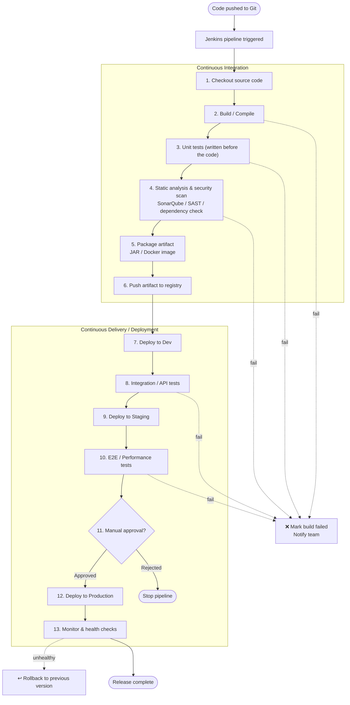
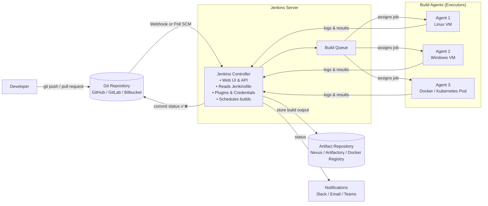
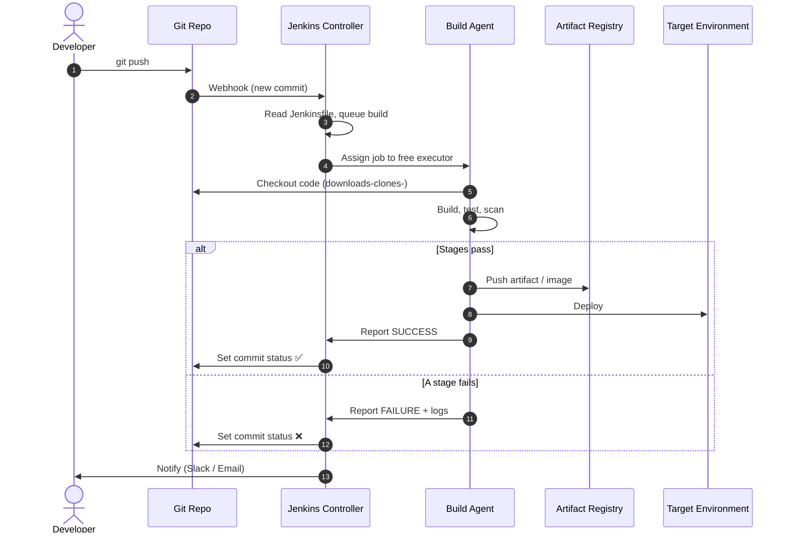
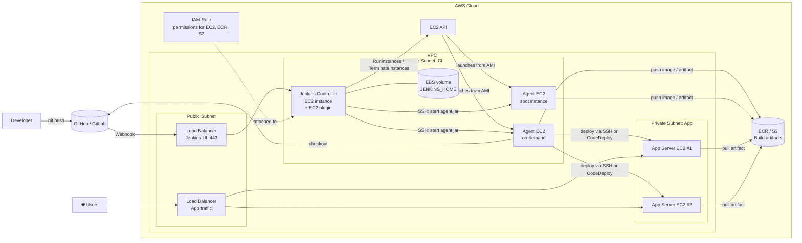

- [Intro to Jenkins \& CICD](#intro-to-jenkins--cicd)
  - [What is CI?](#what-is-ci)
  - [What is CD? Pros?](#what-is-cd-pros)
  - [CI/CD Pipeline Flow](#cicd-pipeline-flow)
- [Jenkins](#jenkins)
  - [Jenkins Architecture](#jenkins-architecture)
  - [Webhook](#webhook)
  - [What Happens During a Single Run](#what-happens-during-a-single-run)
  - [Why use Jenkins?](#why-use-jenkins)
  - [Stages of Jenkins](#stages-of-jenkins)
  - [Example Jeankinsfile](#example-jeankinsfile)
  - [Key Concepts](#key-concepts)
  - [Alternatives to Jenkins](#alternatives-to-jenkins)
  - [Why build pipeline? Buisness value?](#why-build-pipeline-buisness-value)
  - [Jenkins + AWS EC2 Integration](#jenkins--aws-ec2-integration)
    - [1. Architecture](#1-architecture)


# Intro to Jenkins & CICD

## What is CI?
* Continous Integration
* Automatically merging code
* Triggered by: Developers frequently pushing the code changes to shared repo
* Automatic tests are run on the code before main code integration
  
> **Benefits**
> 
> Help you identify and resolve bugs/issues early -> reduced costs
> 
> Helps to maintain stability and functionality of the software build
## What is CD? Pros?
* Can refer to continous Deployment(automatically deploys code to production)/Delivery(manual sign off/approval)
  
Continous Delivery -> ensures software is always in a deployable state, ready/ can bee pushed to production any time
* often involves producing deployable artifact
* requires manual release decision
  > **Benefit** 
  >
  > always have a deployable artifact
  
Continous Deployment (automatically deploys code to production)
* extends Continous Delivery by automating the final step of deploying to production

> **benefits** 
> 
> no manual intervention required
> 
> which is also a disadvantage as:
> removes human approval, relys entirely on automated proccesses


##  CI/CD Pipeline Flow




# Jenkins

* automation server
* open-source
* primarily used for CICD, bu can automate more 


##  Jenkins Architecture


## Webhook
-> a notification
-> webhook is sent by git and is being listened for by Jenkins

##  What Happens During a Single Run



## Why use Jenkins? 
> **Benefits**
>
> * Automation
> * Extensibility: Jenkins has over 180 plugins
> * Scalability - server can scale easily by adding/using worker nodes/agents to run jobs
> * community support
> * cross-platofrm- across windows linux macos

> **Disadvanages**
> * Can be comlex for beginners
> * Maintainance overhead
> * resource- intensive when running multiple jobs
> * outdated user interface


## Stages of Jenkins

A typical CICD pipeline involves stages - 

1. Source Code management (SCM)
2. Build: Complie the code, build into executable artifact
3. Test: Automated tests (unit,integration,etc)
4. Package: Package into deployable artifact
5. If using Cont. Deployment, the package is deployed into the target environment e.g test, producation
6. Monitor: Monitoring tools may be deployed/configured to observe performance, log issues etc after deployment
  
## Example Jeankinsfile
```groovy
pipeline {
    agent any

    stages {
        stage('Checkout') {
            steps { checkout scm }
        }
        stage('Build') {
            steps { sh 'mvn clean compile' }
        }
        stage('Test') {
            steps { sh 'mvn test' }
        }
        stage('Package') {
            steps { sh 'docker build -t myapp:${BUILD_NUMBER} .' }
        }
        stage('Push') {
            steps { sh 'docker push myregistry/myapp:${BUILD_NUMBER}' }
        }
        stage('Deploy to Staging') {
            steps { sh './deploy.sh staging' }
        }
        stage('Approve Production') {
            steps { input message: 'Deploy to production?' }
        }
        stage('Deploy to Production') {
            steps { sh './deploy.sh production' }
        }
    }

    post {
        success { echo 'Pipeline succeeded' }
        failure { echo 'Pipeline failed - notify team' }
    }
}
```
## Key Concepts

| Term | Meaning |
|---|---|
| **Controller** | The main Jenkins server: hosts the UI, stores config, schedules jobs |
| **Agent** | A machine or container that actually runs build steps |
| **Executor** | A slot on an agent that can run one build at a time |
| **Jenkinsfile** | Pipeline-as-code file stored in the repo that defines the stages |
| **Stage / Step** | A stage is a logical phase (Build, Test); steps are the commands inside it |
| **Trigger** | What starts a build: webhook, polling, schedule (cron), or manual |
| **CI** | Automatically build and test every change |
| **CD** | Automatically deliver/deploy tested changes to environments |

## Alternatives to Jenkins
* Gitlab CI
* Github Actions
* Circle CI
* Travis CI
* Bamboo
* TeamCity
* Azure Devops(Azure pipelines)

## Why build pipeline? Buisness value?
* cost savings - automating repetitive processes
* faster time to market
* reduced risk of human error
* improved quality through continous feedback and improvement

## Jenkins + AWS EC2 Integration

Jenkins server: has three jobs that make up the pipeline:

Job 1 – CI: Test. Runs the tests on the new code

Job 2 – CI: Merge. Merges the code (from the dev branch)

Job 3 – CD: Deploy. Deploys the updated app

Built-in (master) node: set up so that jobs don’t run on it. Its role is to manage and 

delegate: it queues jobs, starts worker nodes, and hands jobs out to them

Worker (agent) nodes: EC2 instances launched from a custom AMI that already has all the 

dependencies the jobs need installed

### 1. Architecture




