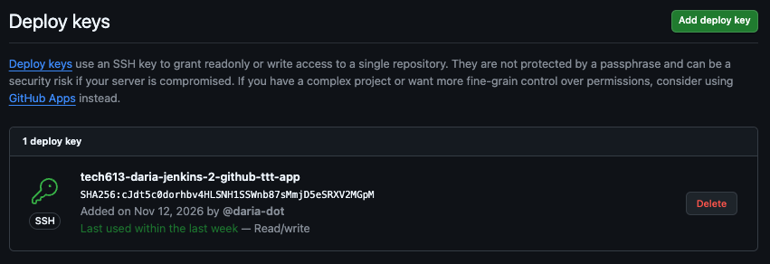

## Getting started with Jenkins and github

1. Generate private keys for jenkins
   
```ssh-keygen -t ed25519 -a 100 -C "jenkins@ttt-scm-3job-cicd"```
```firstname-jenkins-2-github-ttt-app```

on repo go settings > deploy keys > paste key.pub

3. Get URL to the repo and paste in 

for r


setting up a webhook

github > webhook > payload URL
get url of jenkins

http://54.73.244.32:8080/github-webhook/


 GitHub hook trigger for GITScm polling

