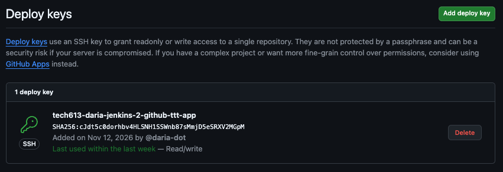
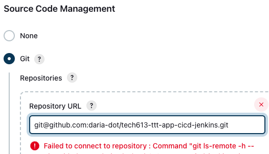
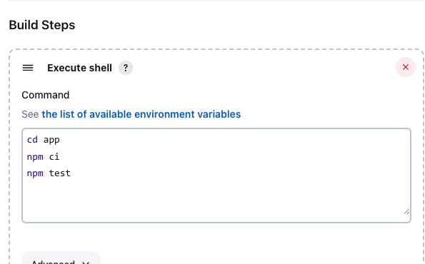
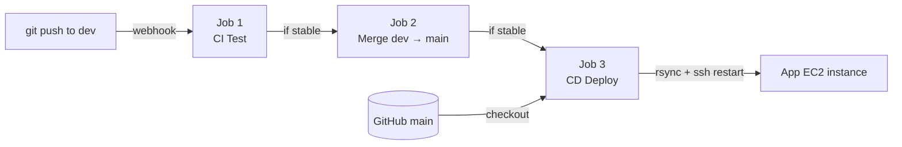
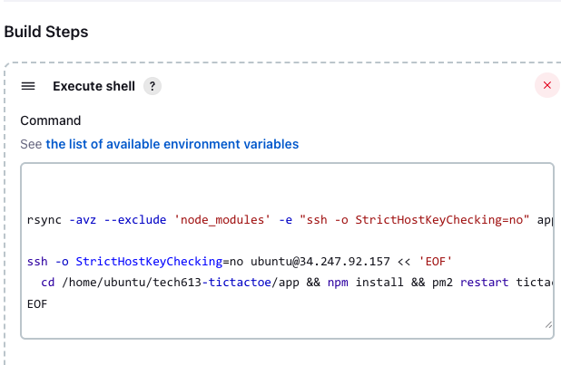
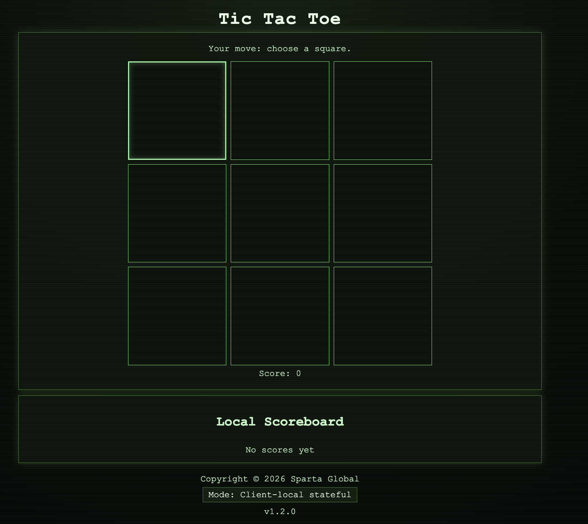
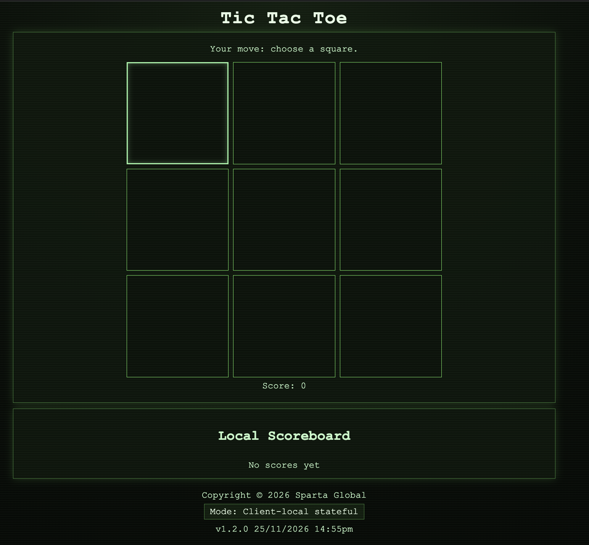

## Automatically pushing changes to ttt app via Jenkins
- [Automatically pushing changes to ttt app via Jenkins](#automatically-pushing-changes-to-ttt-app-via-jenkins)
  - [1. Generate private keys for jenkins](#1-generate-private-keys-for-jenkins)
  - [2. Add the public key to the GitHub repo (Deploy key)](#2-add-the-public-key-to-the-github-repo-deploy-key)
  - [3. Add the private key to Jenkins (Credentials)](#3-add-the-private-key-to-jenkins-credentials)
  - [4. Connect the Jenkins job to the repo](#4-connect-the-jenkins-job-to-the-repo)
  - [5. Set up the webhook on GitHub](#5-set-up-the-webhook-on-github)
- [Job 2 – CI Merge (dev → main)](#job-2--ci-merge-dev--main)
  - [1. Create the job](#1-create-the-job)
  - [3. Source Code Management → Git](#3-source-code-management--git)
  - [5. Post-build Actions → Git Publisher](#5-post-build-actions--git-publisher)
  - [6. Link Job 1 → Job 2](#6-link-job-1--job-2)
- [APP deployment](#app-deployment)
  - [1. App instance](#1-app-instance)
  - [2. Security group](#2-security-group)
  - [3. Add the EC2 key to Jenkins](#3-add-the-ec2-key-to-jenkins)
  - [4. Configure Job 3](#4-configure-job-3)
  - [5. Link Job 2 → Job 3](#5-link-job-2--job-3)
  - [6. Test](#6-test)


### 1. Generate private keys for jenkins
   
```ssh-keygen -t ed25519 -a 100 -C "jenkins@ttt-scm-3job-cicd"```


- When asked for a passphrase, press **Enter** to leave it empty, so Jenkins can use the key without a password prompt.


### 2. Add the public key to the GitHub repo (Deploy key)
on repo go settings > deploy keys > paste key.pub

```bash
cat ~/.ssh/firstname-jenkins-2-github-ttt-app.pub
```



### 3. Add the private key to Jenkins (Credentials)

```firstname-jenkins-2-github-ttt-app```


### 4. Connect the Jenkins job to the repo

1. **New Item** → enter the job name `firstname-job1-ci-test` → **Freestyle project**
2. **General:**  tick **GitHub project** → Project URL: `https://github.com/<username>/<repo>/`
3. **Source Code Management → Git**
   - **Repository URL:** the **SSH URL** of the repo (on GitHub, click **Code → SSH**)
     ```
     git@github.com:<username>/<repo>.git
     ```
   - **Credentials:** select the key added in step 3
   - **Branches to build:** `*/dev`

### 5. Set up the webhook on GitHub

1. Get the URL of your Jenkins server (public IP of the EC2 instance + port 8080).
2. On the repo: **Settings → Webhooks → Add webhook**
3. **Payload URL:**
   ```
   http://54.73.244.32:8080/github-webhook/

### 6. Turn on the webhook trigger in the Jenkins job

1. Job → Configure → Build Triggers
2.  Tick **GitHub hook trigger for GITScm polling**
3. **Save**

### 7. Test it

```bash
git add .
git commit -m "test webhook"
git push origin dev
```



## Job 2 – CI Merge (dev → main)

What it does: if Job 1's tests pass, Job 2 merges the `dev` branch into `main` and pushes `main` back to GitHub.

### 1. Create the job
New Item → name e.g. `firstname-job2-ci-merge` → Freestyle project

### 3. Source Code Management → Git
- Repository URL: `git@github.com:<username>/<repo>.git`
- Credentials: the same SSH key as Job 1
- Branches to build: `*/dev`
- Additional Behaviours → Add → Merge before build
  - Name of repository: `origin`
  - Branch to merge to: `main`

### 5. Post-build Actions → Git Publisher
-  Push Only If Build Succeeds
-  Merge Results
- Branches → Add Branch
  - Branch to push: `main`
  - Target remote name: `origin`

### 6. Link Job 1 → Job 2
In Job 1 → Configure → Post-build Actions → Build other projects:
- Projects to build: `firstname-job2-ci-merge`
- Trigger only if build is stable


## APP deployment

Job 3 copies the tested code from Jenkins to the app EC2 instance, then SSHs in and restarts the app.

The app instance never runs `git clone`. Jenkins already has the exact code that passed the tests, so that is what gets deployed.



### 1. App instance

- Ubuntu 22.04/24.04 with Node JS 20, pm2 and nginx installed
- nginx reverse proxy set up with `sed`:
  ```bash
  sudo sed -i 's|try_files $uri $uri/ =404;|proxy_pass http://localhost:3000;|' /etc/nginx/sites-available/default
  sudo systemctl restart nginx
  ```
- Find where the app runs from:
  ```bash
  pm2 show tictactoe
  ```
  exec cwd: `/home/ubuntu/tech613-tictactoe/app`
- Find the public IP: EC2 console → Details, or `curl -s ifconfig.me`


### 2. Security group

App instance SG → Edit inbound rules → SSH, port 22, source `0.0.0.0/0` (or the Jenkins worker SG for better security)


### 3. Add the EC2 key to Jenkins

Manage Jenkins → Credentials → Global → Add Credentials

- Kind: SSH Username with private key
- Username: `ubuntu`
- Private Key: paste the whole `.pem` file (open it with Notepad, not the certificate viewer)

| Key | Used for |
|---|---|
| GitHub deploy key | Jenkins ↔ GitHub (SCM) |
| EC2 `.pem` key | Jenkins ↔ app instance (SSH Agent) |


### 4. Configure Job 3

New Item → `daria-ttt-job3-cd-deploy` → Freestyle project

| Section | Setting |
|---|---|
| General | Restrict where this project can be run → worker node label |
| Source Code Management | Git, repo SSH URL, GitHub key, branch `*/main` |
| Build Triggers | None (Job 2 triggers it) |
| Build Environment | SSH Agent → EC2 key |
| Post-build Actions | None (last job) |

SCM is needed because every job starts with an empty workspace.

Build Steps → Execute shell:



```bash
rsync -avz --exclude 'node_modules' -e "ssh -o StrictHostKeyChecking=no" app/ ubuntu@<APP_EC2_PUBLIC_IP>:/home/ubuntu/tech613-tictactoe/app/

ssh -o StrictHostKeyChecking=no ubuntu@<APP_EC2_PUBLIC_IP> << 'EOF'
  cd /home/ubuntu/tech613-tictactoe/app && npm install && pm2 restart tictactoe
EOF
```

- `rsync -avz`: copies the `app` folder from the Jenkins workspace to the folder the app runs from, sending only changed files
- `--exclude 'node_modules'`: skipped, `npm install` rebuilds it
- `StrictHostKeyChecking=no`: skips the "are you sure?" prompt Jenkins can't answer
- `npm install`: installs any new packages
- `pm2 restart tictactoe`: restarts the app with the new code
- `&&`: stops if a step fails, so a wrong path can't take the app down

User data only runs on first boot, so the restart has to be in Job 3.


### 5. Link Job 2 → Job 3

Job 2 → Post-build Actions → Build other projects → `daria-ttt-job3-cd-deploy` → Trigger only if build is stable


### 6. Test

1. Change the front page on `dev` (add a timestamp) line 99 in server.js
2. `git add .` → `git commit -m "change front page"` → `git push origin dev`
3. Job 1 → Job 2 → Job 3 run, Job 3 shows "Started by upstream project daria-ttt-job2-ci-merge"
4. Refresh `http://<APP_EC2_PUBLIC_IP>`, the change shows

Before:




After:


If the app goes down:

```bash
cd ~/tech613-tictactoe/app
pm2 start index.js --name tictactoe
pm2 save
```