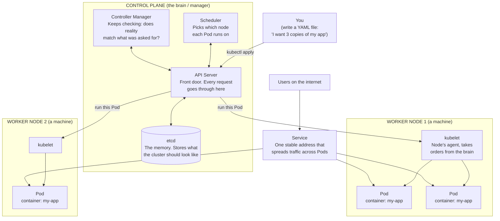
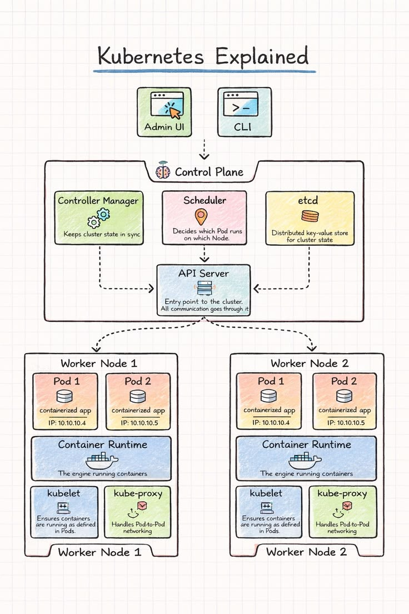

# Kubernetes

## Challenges facing big organisations

* **handling traffic/load on their applications**
* **cybersecurity - and usiing AI to assist**
* migration to the cloud, legacy application were not designed to run on cloud
  * controlling cost, auditing 
* how to use AI to speed up development,testing deployment - but safely
* data - shadow AI - employees can leak data into AI, then ai can be accessed
* may want to use kubernetes
  * enough expertise? - how to get a container back up if it stops running? what happens if theres data loss?
  * need to be able to abstract complexity of kubernetes away from developers
* energy/ sustainability

## Intro to Kubernetes

* Why is kuberenetes needed
    * manage containers, especially to make things more resilient + scalable
*  Benefits of Kuberenetes

    * orchestrate/schedule and manage containers at scale
    * open source
    * can run practically anywhere
    * self healing
    * auto-scaling
    * load balancing
    * rolling updates and rollbacks -> application doesnt need to be shut down -> no need to take the container down, application keeps running
    * define the defined state for the application
    * increased velocity, efficiency, scaling, reducing latency
  
* Success stories
    * Pokemon go application
* Kubernetes architecture 
  
## Diagram

 

 ## Cluster

 > What is a cluster?
  
* at least one master node
* must have at least worker node
* single node setup is only for dev/testing env - can use MiniKube
* Azure Kubernetes Service(AKS) - how it works
* Master node and worker nodes are kept separate
* with AKS...
* Azure takes of master node
* on VM will run each worker node (paid for each)
* on AWS Elastic kubernetes service (EKS) or google kubernetes engine (GKE)
    * Charge for the master node
  * extra benefit: kuberenetes dashboard on the cloud provider's console/portal

> Minikube 
* both the ,aster and worker nodes run on a single VM
* good for experimentation and learning or dev/testing 
  
> Master vs worker nodes
* Master node:
  * runs k8s control plane ( Master nodes)
  * manging k8s , managing worker nodes & what is run on them
  * how many needed for prod env ?
        * Min of 3 control plane/master nodes
        * if using cloud managed k8s you dont need to worry about them
* Worker nodes
    * often just called `nodes`
    * where your containers will be deploy and run
    * work on the data plane
* Pros and cons of using managed service vs launching your own 
    * Manges service benefits:
    * Less experts required
    * security - less maintanance
    * save time not having to work out as issues with master nodes
    * focus on delivering value to customers 
* Managed service disadvantage:
  * GKE and EKS -need to pay for master node
  

> Pros and cons of using managed service vs launching your own

Managed service benefits:

* Less experts required
* security - less maintenance
* save time not having to work out as issues with master nodes
* focus on delivering value to customers

Managed service disadvantage:
* GKE and EKS - need to pay for master node

  * Control plane vs data plane
* Kubernetes objects
  * Research the most common ones, e.g. Deployments, ReplicaSets, Pods
  * What does it mean a pod is "ephemeral" --> temporary
  * you should expect it to disappear at any moment and never be brought back
> How to mitigate security concerns with containers
  * use maintained container images
  * use automatic vunreability scanning on container registry
  * scan your own security scanning tools on your container images
  * NEVER run container with root privilages
  * Monitor and/or log container activity 
  
> Maintained container images
  * What are they
  * container image which is regularly updated, managed by a maintainer
  * maintainer could be an organisation, a community or an individual e.g ubuntu images maintained by Canonical (trustworthy sources)
  * designed to reliable, secure, up to date foundations for building/running applications
  * Pros and cons of using maintained images for your base container images

## Types of autoscaling with k8s

  
* Horizontal Pod Autoscaler (HPA)
  * Purpose: Auto scale the number of pods in a deployment, replicaset or stateset based on observed CPU or memory usage or custom metrics
  * Configruation: Using K8s resource definition
* Cluster Autoscaler:
  * Purpose: Auto adjustment of size of the K8s cluster (number of nodes) based on pending pods & usage
  * Configuration: Generally configued at the cluster level
* Vertical Pod Autoscaler (VPA)
  * Purpose: Auto adjument of the limits of containers in pods
  * Configured: Using K8s resource definition
* KEDA (K8s Event-driven Autoscaling)
  * Purpose: Provide more fine-grained autoscaling based on a variety of event sources (beyond CPU/memory) like custom metrics, external metrics & event source such as message queues
  * Configuration: Integrates with HPA & additional setup