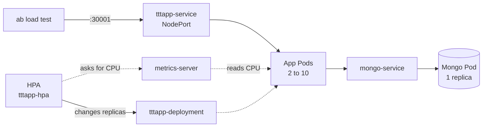
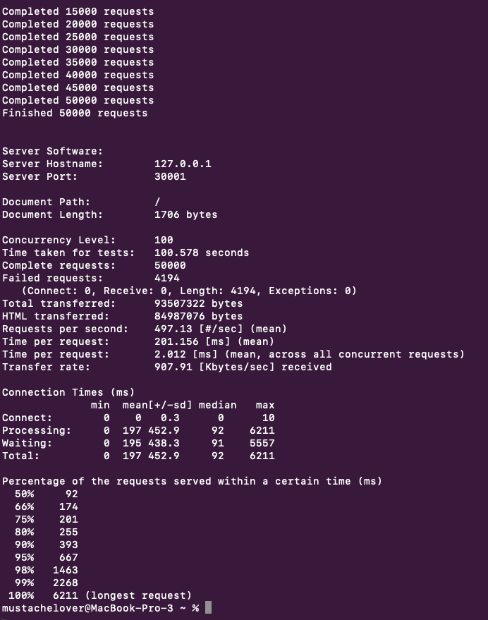

# Kubernetes notes: autoscaling the tic-tac-toe app with an HPA


- Scale the app between 2 and 10 Pods based on CPU, using a Horizontal Pod Autoscaler (HPA)
- keep MongoDB at 1 Pod
- Test it with a load test using Apache Bench



How it works:

1. Metrics-server collects each Pod's CPU usage.
2. The HPA checks it every 15 seconds and compares it to the target (50%).
3. If CPU is too high, it adds Pods. If it's low for about 5 minutes, it removes Pods.


## Step 1: Install metrics-server 

  - so that HPA can see CPU usage

```bash
kubectl apply -f https://github.com/kubernetes-sigs/metrics-server/releases/latest/download/components.yaml
```


```bash
kubectl patch deployment metrics-server -n kube-system --type=json -p '[{"op":"add","path":"/spec/template/spec/containers/0/args/-","value":"--kubelet-insecure-tls"}]'
```

Wait a minute, then check it works:

```bash
kubectl top nodes
```


## Step 2: Go to the folder

```bash
cd kubernetes/yaml-definitions/ttt-app-hpa
ls
```


## Step 3: App Deployment changes

```yaml
spec:
  #  the HPA controls the number of Pods
  selector:
    ...
      containers:
      - name: tttapp
        image: dashaneuro/tech613-tttapp:1.2.0
        ...
        resources:
          requests:
            cpu: 50m       # 50 millicores = 0.05 of a CPU
            memory: 64Mi
          limits:
            cpu: 200m      # a Pod can't use more than 0.2 of a CPU
            memory: 256Mi
```


## Step 4: HPA file

`app-hpa.yml`:

```yaml
apiVersion: autoscaling/v2
kind: HorizontalPodAutoscaler
metadata:
  name: tttapp-hpa
spec:
  scaleTargetRef:          
    apiVersion: apps/v1
    kind: Deployment
    name: tttapp-deployment
  minReplicas: 2          
  maxReplicas: 10         
  metrics:
  - type: Resource
    resource:
      name: cpu
      target:
        type: Utilization
        averageUtilization: 50   # add pods when average CPU is above 50% of the request
```

The HPA works out how many Pods it wants with:

```
desired Pods = current Pods × (current CPU % ÷ target %)   (rounded up)
```


## Step 5: Deploy everything

```bash
kubectl apply -f .
```

```
deployment.apps/tttapp-deployment created
horizontalpodautoscaler.autoscaling/tttapp-hpa created
service/tttapp-service created
persistentvolumeclaim/mongo-pvc created
deployment.apps/mongo-deployment created
service/mongo-service created
```

Check :

```bash
kubectl get pods
kubectl get hpa
```


## Step 6: Load test

Use two terminals.

**Terminal 1:** watch the HPA.

```bash
kubectl get hpa -w
```

**Terminal 2:** send 50,000 requests, 100 at a time.

```bash
ab -n 50000 -c 100 http://127.0.0.1:30001/
```

- `-n 50000`: total requests
- `-c 100`: how many at the same time
- Use `127.0.0.1`, not `localhost`. On a Mac, `localhost` can resolve to IPv6, which `ab` has problems with.
- The trailing `/` is required.

## Step 7: Results

### HPA scaling

```
NAME         REFERENCE                      TARGETS              MINPODS   MAXPODS   REPLICAS   AGE
tttapp-hpa   Deployment/tttapp-deployment   cpu: <unknown>/50%   2         10        0          13s
tttapp-hpa   Deployment/tttapp-deployment   cpu: <unknown>/50%   2         10        1          60s
tttapp-hpa   Deployment/tttapp-deployment   cpu: 269%/50%        2         10        2          2m2s
tttapp-hpa   Deployment/tttapp-deployment   cpu: 75%/50%         2         10        4          3m2s
tttapp-hpa   Deployment/tttapp-deployment   cpu: 11%/50%         2         10        8          4m2s
tttapp-hpa   Deployment/tttapp-deployment   cpu: 16%/50%         2         10        10         5m2s
tttapp-hpa   Deployment/tttapp-deployment   cpu: 3%/50%          2         10        10         6m2s
tttapp-hpa   Deployment/tttapp-deployment   cpu: 2%/50%          2         10        10         7m2s
tttapp-hpa   Deployment/tttapp-deployment   cpu: 3%/50%          2         10        6          8m3s
tttapp-hpa   Deployment/tttapp-deployment   cpu: 5%/50%          2         10        4          9m3s
```

| Time | CPU | Pods | What happened |
|---|---|---|---|
| 13s–60s | N/A | 0 → 1 | No CPU data yet. The Deployment starts with its default of 1 Pod |
| 2m | 269% | 2 | HPA raises it to the minimum. `ab` is overloading both Pods |
| 3m | 75% | 4 | Still above 50%, so it adds Pods |
| 4m | 11% | 8 | Adds more. CPU readings lag up to a minute behind |
| 5m | 16% | **10** | Reaches the maximum |
| 6–7m | 2–3% | 10 | `ab` has finished. The HPA waits before removing Pods |
| 8–9m | 3–5% | 6 → 4 | Scaling down |
| ~19m | — | **2** | Back to the minimum |

- **269%** means each Pod used about 135m CPU against a 50m request. The 200m limit caps it at 400%.
- **Scale-up happens in steps.** The HPA only reacts when a new CPU reading arrives (about once a minute), and the new Pods spread the load, so it went 2 → 4 → 8 → 10 instead of jumping straight to 10.
- **Scale-down waits about 5 minutes** after the last high reading. This stops it removing and re-adding Pods every time traffic dips.

### Apache Bench output



| Result | Value |
|---|---|
| Requests | 50,000 (100 at a time) |
| Time taken | 100.6 s |
| Requests per second | ~497 |
| Median response time | 92 ms |
| Slowest request | 6.2 s (at the start, with only 2 Pods at their CPU limit) |
| Failed requests | 4,194, all `Length` |

The "failed" requests aren't real errors: `Connect: 0, Receive: 0, Exceptions: 0`. `ab` marks a response as failed when its size differs from the first one it received. Part of the app's page changes between responses, so some came back a different size, but every request was still answered.


## To finish

```bash
kubectl delete -f .
kubectl get all,pvc,hpa
```

To also remove metrics-server:

```bash
kubectl delete -f https://github.com/kubernetes-sigs/metrics-server/releases/latest/download/components.yaml
```
