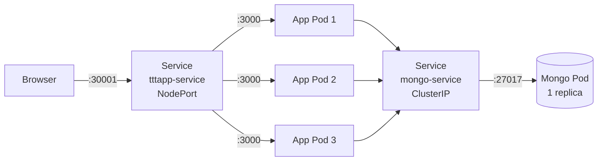
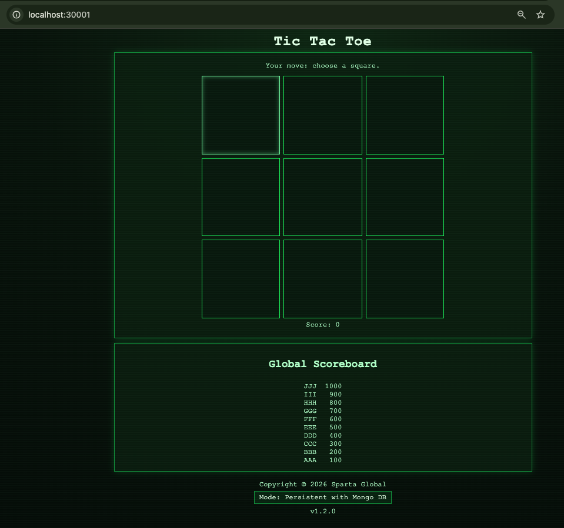

# Kubernetes notes: deploying the tic-tac-toe app with MongoDB

## Overview

- Running the tic-tac-toe app (3 replicas) with a MongoDB database (1 replica) 
- The app is reachable on port 30001, the database is only reachable from inside the cluster





## Make sure


- The app image  is on Docker Hub.
- Nothing else is using port 30001


## Step 1: Go to the folder

```bash
cd kubernetes/yaml-definitions/local-ttt-app-mongo-deploy
ls
```

## Step 2: Database file

`mongo-deploy.yml`. There's no PVC, so the data lives inside the Pod and is lost if the Pod is deleted or restarted

```yaml
apiVersion: apps/v1
kind: Deployment
metadata:
  name: mongo-deployment
spec:
  replicas: 1                # only 1 database
  selector:
    matchLabels:
      app: mongo
  template:
    metadata:
      labels:
        app: mongo
    spec:
      containers:
      - name: mongo
        image: mongo:7.0     # official image from Docker Hub
        ports:
        - containerPort: 27017
        readinessProbe:      # Pod only counts as ready once Mongo answers
          exec:
            command: ["mongosh", "--quiet", "--eval", "db.adminCommand('ping')"]
          initialDelaySeconds: 5
          periodSeconds: 10
          timeoutSeconds: 10
```


## Step 3: Database Service file

`mongo-service.yml`:

```yaml
apiVersion: v1
kind: Service
metadata:
  name: mongo-service        # the app connects using this name
spec:
  type: ClusterIP            # internal only: not reachable from outside the cluster
  selector:
    app: mongo
  ports:
  - port: 27017
    targetPort: 27017
```


## Step 4: Deploy the database and check it

```bash
kubectl apply -f mongo-deploy.yml -f mongo-service.yml
kubectl get pods
```


## Step 5: App file

`app-deploy.yml`:

```yaml
apiVersion: apps/v1
kind: Deployment
metadata:
  name: tttapp-deployment
spec:
  replicas: 3
  selector:
    matchLabels:
      app: tttapp
  template:
    metadata:
      labels:
        app: tttapp
    spec:
      initContainers:        # runs before the app starts, like depends_on in compose
      - name: wait-for-mongo
        image: busybox:1.36
        command: ["sh", "-c", "until nc -z mongo-service 27017; do echo waiting for mongo; sleep 2; done"]
      containers:
      - name: tttapp
        image: dashaneuro/tech613-tttapp:1.2.0
        ports:
        - containerPort: 3000
        env:
        - name: MONGODB_URI
          value: mongodb://mongo-service:27017/tictactoe   # "mongo-service" = the database Service's name
```


## Step 6: App Service file

`app-service.yml`:

```yaml
apiVersion: v1
kind: Service
metadata:
  name: tttapp-service
spec:
  type: NodePort
  selector:
    app: tttapp
  ports:
  - port: 80
    targetPort: 3000         # the app's port in the container
    nodePort: 30001          # open http://localhost:30001
```

## Step 7: Deploy the app and check it

```bash
kubectl apply -f app-deploy.yml -f app-service.yml
kubectl get pods
```


```bash
kubectl get endpoints
```

- `tttapp-service` – 3 addresses ending in `:3000`
- `mongo-service` – 1 address ending in `:27017`

## Step 8: Seed the database


```bash
kubectl exec deploy/tttapp-deployment -- node seeds/seed.js
```

Expected output: `Seeded active app state via /api/seed (10 records).`

## Step 9: Check it works

Open **http://localhost:30001**


## To finish

```bash
kubectl delete -f .
kubectl get all
```

