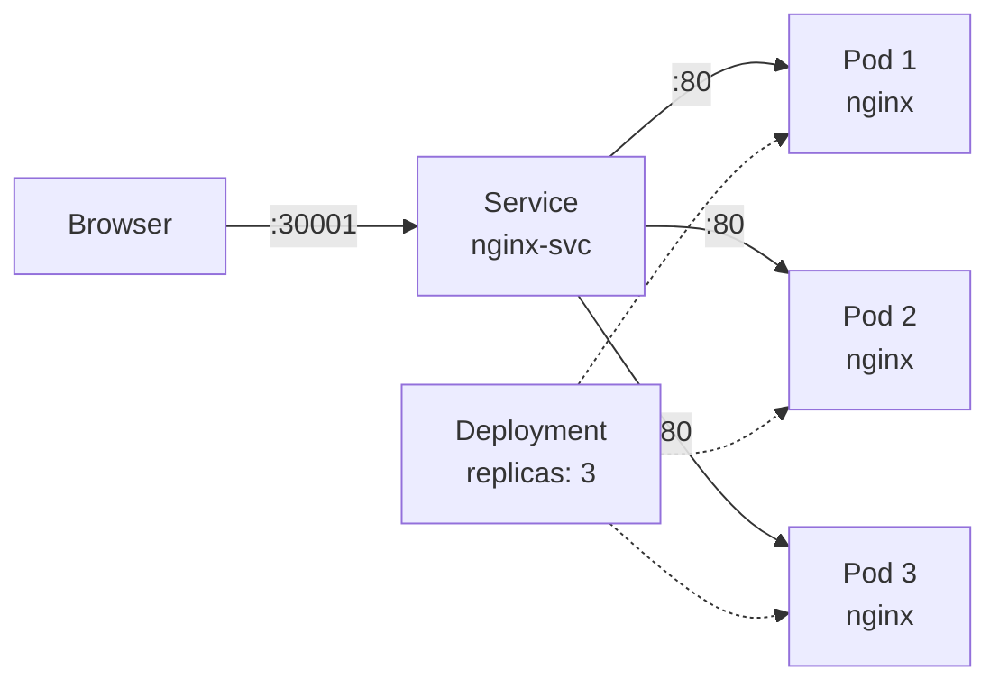

# Kubernetes notes: deploying nginx locally

## Overview

1. Create deployment file with K8s
2. Apply the service file to it
   



## Step 1: Go to the folder with the YAML files

```bash
cd kubernetes
cd yaml-definitions
ls                       
cd local-nginx-deploy
ls                       
```


## Step 2:  Deployment file

The Deployment tells Kubernetes to always keep 3 nginx pods running from the image

```yaml
# YAML is case sensitive. Indent with spaces, never tabs.
apiVersion: apps/v1          # API group that Deployments live in
kind: Deployment             # the type of object to create
metadata:
  name: nginx-deployment     # name of the Deployment
spec:
  selector:
    matchLabels:
      app: nginx             # manage Pods that carry this label
  replicas: 3                # keep 3 Pods running (via a ReplicaSet)
  template:                  # blueprint for each Pod
    metadata:
      labels:
        app: nginx           # label stamped on every Pod; must match the selector above
    spec:
      containers:
      - name: nginx
        image: daraymonsta/nginx-257:dreamteam   # Docker image to run
        ports:
        - containerPort: 80  # port nginx listens on inside the container
```

Key points:

- `selector.matchLabels` and `template.metadata.labels` must match, or the Deployment can't find its own Pods.
- `replicas: 3` is the desired count. The Deployment creates a ReplicaSet, and the ReplicaSet keeps 3 Pods alive.
- The `app: nginx` label is also what the Service uses later to find these Pods.

## Step 3: Create the Deployment and check it

```bash
kubectl create -f nginx-deploy.yml


kubectl get all
```


## Step 4: See the real containers with Docker

```bash
docker ps
```

This should show 3 running containers.


## Step 5:  Service file

The Service gives the 3 Pods one stable address and opens port 30001

```yaml
apiVersion: v1
kind: Service
metadata:
  name: nginx-svc
  namespace: default      # used automatically if left out
spec:
  ports:
  - nodePort: 30001       # port opened on the node; allowed range is 30000-32767
    port: 80              # the Service's own port inside the cluster
    targetPort: 80        # the container's port (matches containerPort)
  selector:
    app: nginx            # send traffic to every Pod with this label
  type: NodePort          # reachable from outside the cluster
```

A request travels through the three ports in order:

```
browser → localhost:30001 (nodePort) → nginx-svc:80 (port) → Pod:80 (targetPort)
```


## Step 6: Create the Service and open the app

```bash
kubectl apply -f nginx-service.yml
# service/nginx-svc created

kubectl get all
```


Open **http://localhost:30001** in a browser to see the nginx page. If that doesn't load, run `kubectl port-forward svc/nginx-svc 8080:80` and open http://localhost:8080 instead.

## Commands

| Command | What it does |
| --- | --- |
| `kubectl create -f <file>` | Creates the objects in a file. Errors if they already exist |
| `kubectl apply -f <file>` | Creates the objects, or updates them if they exist. Use this one by default |
| `kubectl get all` | Lists Pods, Services, Deployments and ReplicaSets |
| `kubectl get pods` | Lists just the Pods |
| `kubectl describe pod <name>` | Shows details and events for one Pod. Good for debugging |
| `kubectl logs <pod-name>` | Shows a Pod's logs |
| `kubectl delete -f <file>` | Deletes everything defined in a file |
| `kubectl port-forward svc/nginx-svc 8080:80` | Opens the Service on localhost:8080 |
| `docker ps` | Lists running Docker containers, including the ones inside Pods |


To clean up when finish:

```bash
kubectl delete -f nginx-service.yml
kubectl delete -f nginx-deploy.yml
```