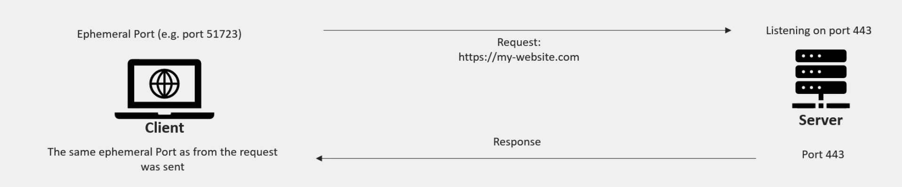

## How do machines communicate?

- machines communicate over networks
  through protocals:
  1. HTTP
  2. SSH
  3. FTP
**via ports**:
- each port is a unique 16-bit number (default)
- SSH 22
- HTTP 80
- HTTPS 443
  

linux shells
- sl
- 