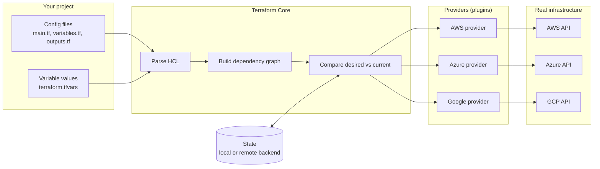

# Terraform: Commands, Files and Providers

## Contents
- [Terraform: Commands, Files and Providers](#terraform-commands-files-and-providers)
  - [Contents](#contents)
  - [CLI commands](#cli-commands)
  - [Project files](#project-files)
    - [State Locking](#state-locking)
      - [Best Practices](#best-practices)
    - [Key State Files](#key-state-files)
  - [Overall](#overall)
    - [Key points](#key-points)
  - [Output](#output)
  - [Providers](#providers)
  - [General](#general)
    - [Module](#module)

## CLI commands

| Command | What it does | Changes infrastructure? |
|---|---|---|
| `terraform init` | Sets up the folder and downloads providers/modules | No |
| `terraform validate` | Checks config for syntax errors and invalid arguments | No |
| `terraform fmt` | Tidies the formatting of `.tf` files | No |
| `terraform plan` | Previews what will be created, changed or destroyed | No |
| `terraform apply` | Makes the changes (asks you to type `yes` first) | **Yes** |
| `terraform show` | Displays current state or a saved plan | No |
| `terraform output` | Prints output values after an apply | No |
| `terraform destroy` | Deletes everything Terraform manages in this config | **Yes** |

Good sequence: `init` → `fmt` → `validate` → `plan` → `apply`.

## Project files

Terraform reads **every** `.tf` file in the folder as one configuration. The names below are conventions for organising code, not requirements.

| File | Purpose |
|---|---|
| `main.tf` | The resources you're creating (servers, networks, databases) |
| `variables.tf` | Declares inputs so code can be reused with different values |
| `outputs.tf` | Values to display after deployment, e.g. an IP address |
| `providers.tf` | Which provider to use and settings like region |
| `versions.tf` | Required Terraform and provider versions |
| `terraform.tfvars` | Actual values for your variables; can have one per environment (`dev.tfvars`, `prod.tfvars`) |
| `backend.tf` | Where to store state remotely, e.g. an S3 bucket |

If a variable is not specified in .tfvars the default will be taken from variables.tf

State Management: Terraform keeps track of your infrastructure using a state file, which records the current status of all the resources it manages. This file helps Terraform understand what already exists, what needs to be created, updated, or destroyed.

### State Locking

Terraform also creates a temporary lock file ```.terraform.tfstate.lock.info``` whenever a command like apply or destroy is running.
This prevents multiple people from making changes at the same time and avoids conflicts or corruption.

#### Best Practices

Never edit the state file manually - always use Terraform commands.
Add the state file to .gitignore to avoid exposing secrets.
For teams, use a remote backend (like AWS S3 or Terraform Cloud) to safely store and share state files.

### Key State Files

terraform.tfstate → The main file that stores information about all managed resources.
terraform.tfstate.backup → A backup copy of the previous state.
These files allow Terraform to compare your desired configuration with the actual infrastructure and decide what changes to make during plan or apply.

## Overall

Terraform Core reads your configuration and state, works out what needs to change, and talks to cloud platforms through providers.



### Key points

- **Config** describes the infrastructure you want (declarative).
- **Core** builds a dependency graph so resources are created in the right order.
- **State** records what Terraform has already created, so it can work out the difference.
- **Providers** translate Terraform resources into API calls for each platform.


Example of a variable and how it's used:

```hcl
variable "instance_type" {
  description = "EC2 instance size"
  default     = "t3.micro"
}

resource "aws_instance" "web" {
  ami           = "ami-0c1c30571d2dae5c9"
  instance_type = var.instance_type
}

output "web_ip" {
  value = aws_instance.web.public_ip
}
```

Example remote backend:

```hcl
terraform {
  backend "s3" {
    bucket       = "my-terraform-state"
    key          = "prod/terraform.tfstate"
    region       = "eu-west-1"
    use_lockfile = true   # state locking
  }
}
```
## Output

You can specify which ids to retrieve that are made after ```terraform apply``` is run. Terraform then prints these onto the screen.

> Never put AWS access keys in `providers.tf`. Use environment variables or `aws configure`.

## Providers

- Terraform itself is just the core engine. **Providers** are plugins that let it talk to a platform's API (AWS, Azure, Google Cloud, GitHub, etc.).
- Without a provider, Terraform can't create or manage anything.
- `terraform init` downloads the providers listed in `required_providers`.

```hcl
terraform {
  required_providers {
    aws = {
      source  = "hashicorp/aws"
      version = "~> 5.0"
    }
  }
}

provider "aws" {
  region = "eu-west-1"
}
```

After `terraform init`, two things appear:
- `.terraform/` — the downloaded provider files (don't commit to Git)
- `.terraform.lock.hcl` — records exact provider versions so everyone uses the same ones (do commit this)

## General

General syntax for writing a resource:

```
resource "<PROVIDER>_<TYPE>" "<NAME>" {
[CONFIG …]
}
```
### Module

```
module "ec2_instance" {
  source        = "terraform-aws-modules/ec2-instance/aws"
  version       = "~> 5.0"
  name          = "my-ec2"
  instance_type = "t2.micro"
  ami           = "ami-065deacbcaac64cf2"
}
```
making a module, create a folder:

main.tf — defines the resources

variables.tf — defines input values

outputs.tf — defines outputs

Then, call it in your root module:
```
module "my_ec2" {
  source = "./modules/ec2"
}
```