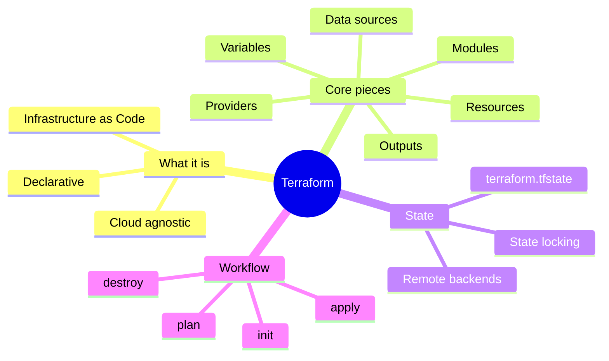
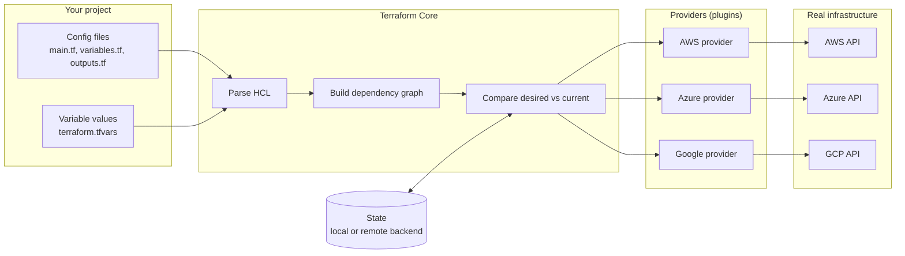

## Intro to Terraform

- [Why use Terraform? The benefits?](#why-use-terraform-the-benefits)
    - [Alternatives to Terraform](#alternatives-to-terraform)
    - [Who is using Terraform in the industry?](#who-is-using-terraform-in-the-industry)
    - [In IaC, what is orchestration?](#in-iac-what-is-orchestration)
    - [How does Terraform act as "orchestrator"?](#how-does-terraform-act-as-orchestrator)
    - [Why use Terraform for different environments (e.g. production, testing, etc)](#why-use-terraform-for-different-environments-eg-production-testing-etc)
    - [How It Works Under the Hood](#how-it-works-under-the-hood)
    - [Key points](#key-points)
    - [Terraform vs Ansible](#terraform-vs-ansible)

### What is Terraform? What is it used for?

* IaC type of tool: orchestration
* infrastructure provisioning tool
  * a tool that creates and sets up the underlying computing resources your applications run automatically
    * servers (virtual machines),   networks, databases, storage buckets, load balancers, DNS records, firewalls
* manage cloud resources
* sees infrastructure as immutable (disposable)
* uses code written in HCL (Hashicorp Configuration Language) - aims to be a good balance between human and machine readable
  * HCL can be converted 1:1 to JSON and vice versa

# Why use Terraform? The benefits?
* declarative - say what you want, not how to do it
* easy to use
* sort of open-source
  
  In 2023, started using Business Source License (BSL). This means...
  * Terraform can't be used to create a competing commerical product
  * Some organisations have started using OpenTofu instead
    * OpenTofu aims to be a drop-in replacement
* Cloud-agnostic - deploy to any cloud provider
  * use different providers (like a plugin) to interface with different cloud providers
  * each cloud vendor maintains its own provider
* Expressive (refering to the language) and extendable (refering to being able to use different providers to manage different resources)

### Alternatives to Terraform

* Pulumi (not declarative)
* AWS CloudFormation, Azure ARM/Bicep templates, GCP Deployment Manager

### Who is using Terraform in the industry?

Some examples:
* Tech Companies and Startups: Uber, Spotify, Airbnb, Coinbase
* Financial Institutions (regulated industry): JPMorgan Chase, Goldman Sachs, Capital One
* Cloud Providers and SaaS Platforms: AWS, Google Cloud, Salesforce
* Media and Entertainment: The New York Times, Netflix
* Healthcare (regulated industry) and Life Sciences: Philips, Cerner
* Telecommunications: Verizon, T-Mobile
* Retail and E-Commerce: Walmart, Target
* Gaming Industry: Electronic Arts (EA), Riot Games (they make/run League of Legends)
* Government and Public Sector: UK Government Digital Service (GDS), NASA
* Consulting and Cloud Services: Accenture, Deloitte
* Education and Research Institutions: Harvard University, MIT

### In IaC, what is orchestration?

* Process of automating and managing the entire lifecycle of infrastructure resources

### How does Terraform act as "orchestrator"?
 
* Co-ordinating the piece of instructure to work together
* Includes
  * setting things up/destroying in the right order
  * makes sure things are connected together properly

To do this, it relies on understanding the dependencies between resources

### Why use Terraform for different environments (e.g. production, testing, etc)

* Production
  * Easily create a larger-scale or more scalable version of infrastructure

* Dev and Testing environments
  * Easily spin up infrastructure for testing/dev that mirrors production
  * Easily tear it down when not needed
  
### How It Works Under the Hood

Terraform Core reads your configuration and state, works out what needs to change, and talks to cloud platforms through providers.

### Key points

- **Config** describes the infrastructure you want (declarative).
- **Core** builds a dependency graph so resources are created in the right order.
- **State** records what Terraform has already created, so it can work out the difference.
- **Providers** translate Terraform resources into API calls for each platform.

### Terraform vs Ansible

| | **Terraform** | **Ansible** |
|---|---|---|
| **Main purpose** | Provisioning infrastructure (creating servers, networks, databases) | Configuration management (installing and configuring software on servers) |
| **Approach** | Declarative: you describe the end state you want | Mostly procedural: you list tasks to run in order (though many modules are declarative) |
| **Language** | HCL (HashiCorp Configuration Language) | YAML playbooks |
| **State** | Keeps a state file to track what it has created | Stateless: checks the current state of machines each run |
| **Agent needed?** | No, talks directly to cloud APIs | No, connects to machines over SSH (or WinRM for Windows) |
| **Typical targets** | Cloud platforms like AWS, Azure, GCP, plus SaaS services | Existing servers, operating systems, applications |
| **Change handling** | Shows a plan of changes before applying | Runs tasks; idempotent modules skip work already done |
| **Infrastructure style** | Suits immutable infrastructure (replace rather than modify) | Suits mutable infrastructure (update servers in place) |
| **Made by** | HashiCorp (now part of IBM) | Red Hat (also part of IBM) |
| **Example task** | "Create 3 EC2 instances and a load balancer" | "Install Nginx and copy config files onto those 3 instances" |

**Using them together:** Terraform builds the servers, then Ansible configures what runs on them.

If people make manual hanges its called configuration drfit

non destructive commands -> makes no difference to the infrastructure, no modifications
init, plan, fmt